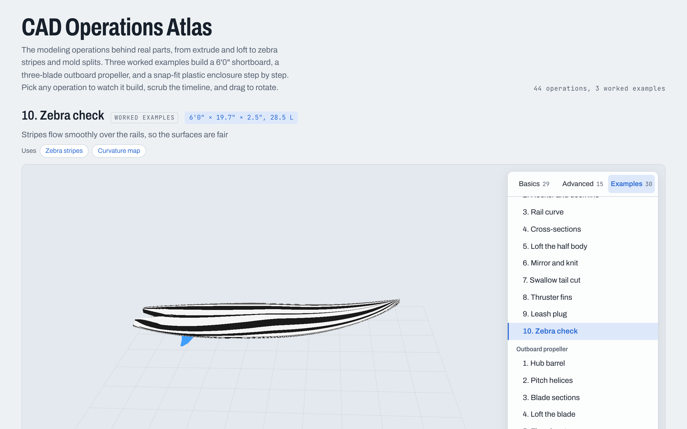
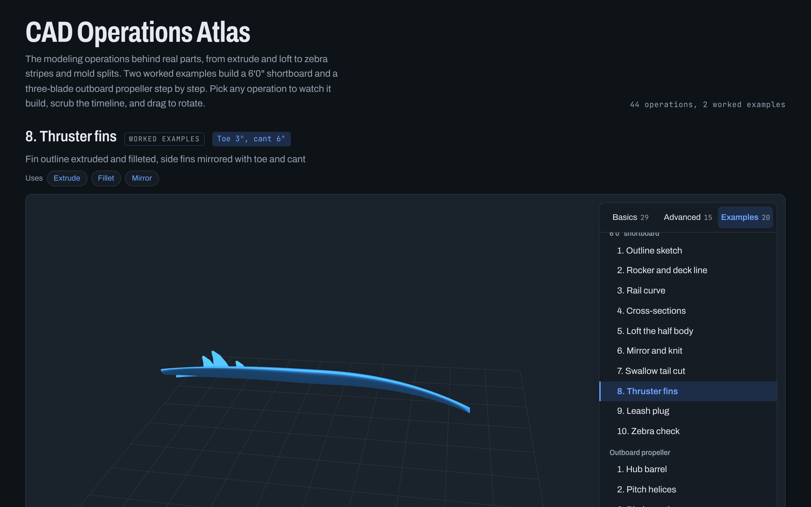
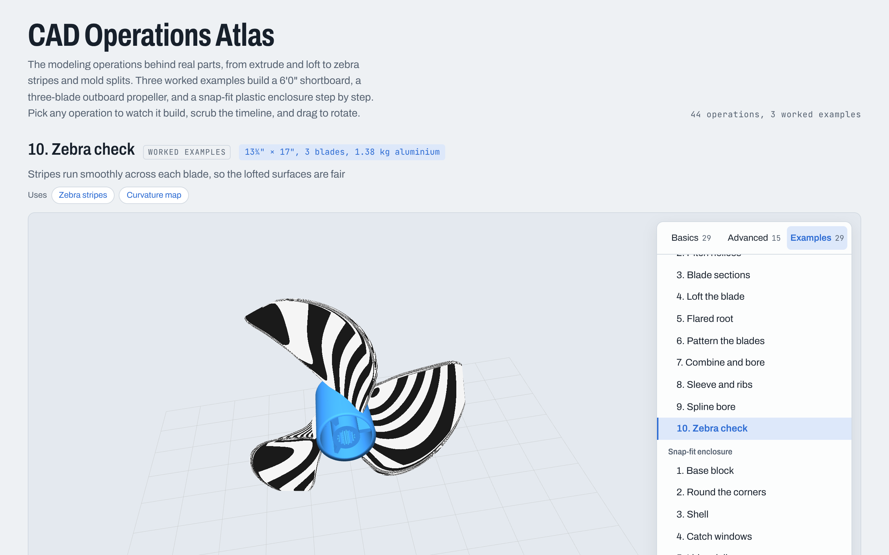
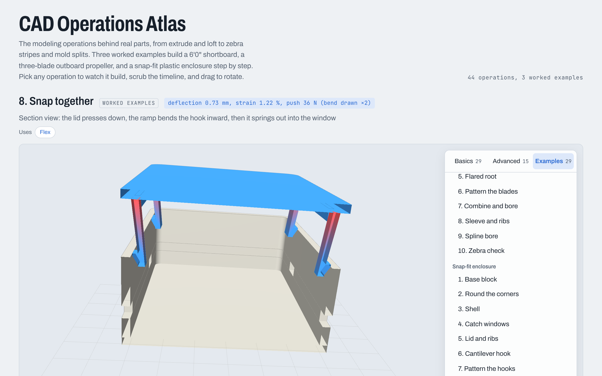
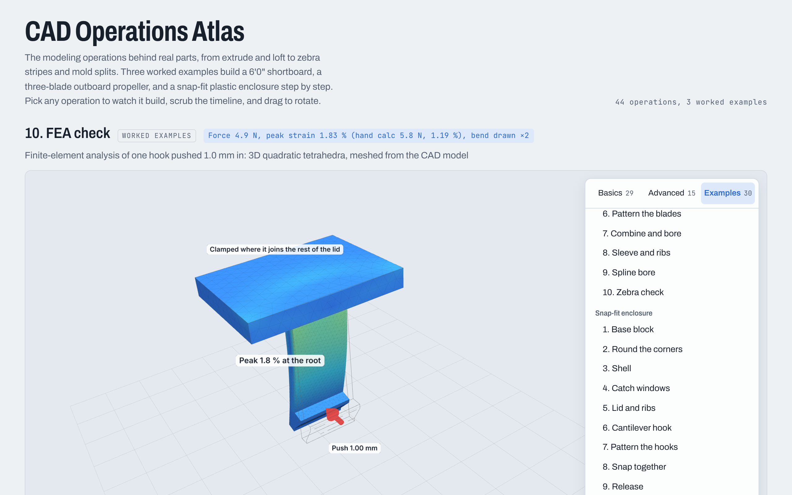

# CAD Operations Atlas

An interactive 3D guide to the modeling operations behind real parts, from extrude and loft to zebra stripes and mold splits. Each operation builds itself in front of you: watch it play, scrub the timeline, and drag to rotate.

**[▶ Open the live demo](https://sesasa.github.io/cad-operations-atlas/)**

[](https://sesasa.github.io/cad-operations-atlas/)

## What's inside

- **44 operations** in two tiers, Basics and Advanced, grouped like a CAD feature tree.
- **Three worked examples**, each built step by step from operations in the atlas:
  - a 6'0" × 19.7" × 2.5" shortboard (28.5 L), from the outline sketch to a zebra-stripe surface check;
  - a 13¼" × 17" three-blade outboard propeller, backed by a real CAD model you can download as a [STEP file](models/propeller.step);
  - an ABS electronics enclosure whose lid clips on with four cantilever snap hooks, with the snap fit animated in a section view, a [STEP assembly](models/snap_enclosure.step), and a finite-element check of the hooks.
- **Deep links** for every operation, so you can share one directly, for example [`#loft`](https://sesasa.github.io/cad-operations-atlas/#loft) or [`#zebra-stripes`](https://sesasa.github.io/cad-operations-atlas/#zebra-stripes).
- Works on phones and follows your system's light or dark mode.

### Basics

| Group | Operations |
| --- | --- |
| Solid features | Extrude, Revolve, Sweep, Loft, Shell, Fillet, Chamfer, Draft, Rib, Cut and hole |
| Curves | 3D spline, Projected curve, Helix, Split line |
| Surfaces | Boundary surface, Fill surface, Offset surface, Ruled surface, Extend surface, Trim surface, Knit surface, Thicken |
| Bodies and patterns | Mirror, Linear pattern, Circular pattern, Combine, Split body, Wrap, Flex |

### Advanced

| Group | Operations |
| --- | --- |
| Advanced features | Variable-radius fillet, Twisted sweep, Loft with guide curves, Modeled thread, Dome, Cut with surface, Curve-driven pattern |
| Freeform and analysis | Subdivision cage, Zebra stripes, Curvature map, Draft analysis, Scan to surface |
| Industry tools | Sheet metal bend, Weldment frame, Core and cavity |

## Worked example 1: a 6'0" shortboard

The Examples tab holds complete parts built only from operations in the atlas. Each step has "Uses" chips that jump to the operations it relies on.

| Step | What happens | Uses |
| --- | --- | --- |
| 1. Outline sketch | Half the plan shape as one spline on the top plane | 3D spline |
| 2. Rocker and deck line | Bottom rocker and deck curve on the side plane | 3D spline |
| 3. Rail curve | Project the outline onto the rocker to get the 3D rail | Projected curve |
| 4. Cross-sections | Five half-sections on reference planes | Loft with guide curves |
| 5. Loft the half body | Loft through the sections, guided by rocker, deck, and rail | Loft with guide curves, Boundary surface |
| 6. Mirror and knit | Mirror across the stringer plane and knit into one solid | Mirror, Knit surface |
| 7. Swallow tail cut | Extruded cut from a V-shaped sketch | Cut and hole |
| 8. Thruster fins | Fins extruded, filleted, and mirrored with toe and cant | Extrude, Fillet, Mirror |
| 9. Leash plug | Revolved cut on the deck | Revolve, Cut and hole |
| 10. Zebra check | Stripes confirm the surfaces are fair | Zebra stripes, Curvature map |



## Worked example 2: an outboard propeller

A 13¼" diameter, 17" pitch, three-blade aluminium propeller with a through-hub exhaust and a 15-tooth spline bore. It comes as a real parametric model: [`models/propeller.py`](models/propeller.py) builds it with [CadQuery](https://cadquery.readthedocs.io/) on OpenCascade (the geometry kernel FreeCAD uses) and exports [`models/propeller.step`](models/propeller.step), which opens in FreeCAD, SOLIDWORKS, Fusion, Onshape and other CAD tools. The page draws the same blade from the same formulas.

| | |
| --- | --- |
| Diameter × pitch | 337.6 mm × 432 mm (13¼" × 17") |
| Blades | 3, raked 15° aft, 28° tip skew |
| Sections | 12 flat-face airfoil sections, pitch angle 67° at the root to 22° at the tip |
| Hub | Barrel Ø74 to Ø66 mm × 100 mm, exhaust passage, sleeve, 3 ribs, 15-tooth spline |
| Volume and mass | 510 cm³, 1.38 kg in aluminium (2.70 g/cm³) |

| Step | What happens | Uses |
| --- | --- | --- |
| 1. Hub barrel | Revolve a tapered profile into the barrel | Revolve |
| 2. Pitch helices | Helices at three radii set the 17" pitch | Helix |
| 3. Blade sections | Twelve airfoil sections, each turned to its pitch angle, raked and skewed | 3D spline |
| 4. Loft the blade | Smooth loft through the sections, guided by leading and trailing edges | Loft with guide curves |
| 5. Flared root | Root sections grow wider and thicker, blending into the hub | Variable-radius fillet |
| 6. Pattern the blades | Copy the blade twice around the shaft axis | Circular pattern |
| 7. Combine and bore | Join blades and barrel, then cut the exhaust passage | Combine, Cut and hole |
| 8. Sleeve and ribs | Inner sleeve tied to the barrel by three ribs | Revolve, Rib, Circular pattern |
| 9. Spline bore | 15-tooth spline cut through the sleeve | Cut and hole, Circular pattern |
| 10. Zebra check | Stripes run smoothly across each blade | Zebra stripes, Curvature map |

[](https://sesasa.github.io/cad-operations-atlas/#propeller-10)

To rebuild the STEP file after changing a dimension:

```sh
pip install cadquery
python models/propeller.py
# valid: True  diameter: 337.6 mm  length: 112.1 mm  volume: 510.1 cm3  mass (Al 2.70 g/cm3): 1.38 kg
```

A note on the root: a true variable-radius fillet between the lofted blade and the conical barrel fails in OpenCascade, a common problem with this kind of intersection. The model uses the usual propeller-design alternative instead: the root sections flare wider (+20 mm chord) and thicker (+9 mm), so the loft itself blends into the hub with a radius that varies along the chord.

## Worked example 3: a snap-fit enclosure

> This example also has its own project, **[snap-fit-enclosure](https://github.com/sesasa/snap-fit-enclosure)** ([live demo](https://sesasa.github.io/snap-fit-enclosure/)), which adds a side-by-side view of the three FEA designs and a mesh-convergence chart.

An 80 × 50 × 24 mm ABS box. Four cantilever hooks on the lid pass down inside the base walls, and their heads catch in windows cut through the long walls. [`models/snap_enclosure.py`](models/snap_enclosure.py) builds both parts with CadQuery, checks that they don't overlap when closed, works out the snap-fit numbers, and exports [`models/snap_enclosure.step`](models/snap_enclosure.step) as a two-part assembly. [`models/snap_fea.py`](models/snap_fea.py) then checks one hook with a finite-element analysis (below), which changed the design.

| Hook | |
| --- | --- |
| Beam | 12 mm long, 6 mm wide, tapering from 1.6 mm at the root to 1.0 mm at the head |
| Root | R0.6 fillets on all four root edges; 1 mm lead-in chamfer on the base rim gives them room |
| Head | 1.2 mm undercut, 30° lead-in ramp, 90° retaining face |
| Deflection while closing | 1.0 mm (undercut minus 0.2 mm clearance) |
| Peak strain | 1.19 % by hand calculation, **1.83 % by FEA** at the root fillet; ABS one-time limit 2.5 % |
| Force to bend one hook | 5.8 N by hand calculation, **4.9 N by FEA** |
| Force to close the lid | about 9 N per hook, 35 N for all four (hand calculation; the FEA stiffness gives about 30 N) |
| Parts | base 18.3 g, lid 9.5 g |

The hand numbers use the cantilever formulas in the Bayer/Covestro snap-fit design guide, integrated along the tapered beam (for a constant section they reduce to ε = 1.5·y·h / l² and P = b·h²·E·ε / (6·l)), with mating force W = P·(μ + tan α) / (1 − μ·tan α), E = 2.3 GPa and μ = 0.5 for ABS on ABS.

| Step | What happens | Uses |
| --- | --- | --- |
| 1. Base block | Extrude an 80 × 50 mm rectangle 22 mm tall | Extrude |
| 2. Round the corners | 4 mm fillets on the vertical edges | Fillet |
| 3. Shell | Open the top and hollow to a 2 mm wall | Shell |
| 4. Catch windows | Four 7 × 3 mm windows through the long walls, 1 mm chamfer on the inner rim | Cut and hole, Mirror |
| 5. Lid and ribs | 2 mm lid; ribs just inside the walls locate it | Extrude, Rib |
| 6. Cantilever hook | Sketch the tapered hook profile, extrude it 6 mm, fillet the root | Extrude, Fillet |
| 7. Pattern the hooks | Repeat along the wall, mirror to the far side | Linear pattern, Mirror |
| 8. Snap together | **Motion, in section:** the rim bends the hooks inward, then they spring out into the windows | Flex |
| 9. Release | **Motion, in section:** a screwdriver presses each hook in through its window, then the lid lifts | Flex |
| 10. FEA check | The finite-element result for one hook: deformed mesh colored by strain | |

[](https://sesasa.github.io/cad-operations-atlas/#snap-fit-8)

**How the motion is made.** Steps 8 and 9 are scripted, like a SOLIDWORKS *Animation* motion study: the lid follows keyframes, and at each lid height the page works out how far the wall pushes each hook in, bends the beam along the cantilever curve, and colors it by beam-theory strain. The badge shows live deflection, strain and push force; force arrows mark the contact; bending is drawn at twice its real size. It is not a physics simulation. SOLIDWORKS *Motion* studies treat parts as rigid, so they can't show a hook bending either; that needs a nonlinear FEA study such as SOLIDWORKS Simulation Premium. Step 10 shows the finite-element result.

### FEA check of the hook

[](https://sesasa.github.io/cad-operations-atlas/#snap-fit-10)

**Model.** One hook plus a 16 × 12 mm patch of the lid, taken straight from the CAD model (CadQuery), meshed with tetrahedra in [gmsh](https://gmsh.info/) and solved with quadratic (P2) elements in [scikit-fem](https://github.com/kinnala/scikit-fem), with a PARDISO direct solver. ABS, linear elastic: E = 2.3 GPa, ν = 0.35. The patch is clamped where it joins the rest of the lid. The wall's push is an even pressure on the head's contact face, so the head is free to tilt, scaled so the face moves 1.0 mm. Linear analysis is enough here: the deflection is 8 % of the beam length.

**Mesh study.** Peak max-principal strain on the beam, root and lid (the loaded head face is left out), as the mesh at the root is refined:

| Design | Root mesh 0.24 mm | 0.12 mm | 0.08 mm | Force (FEA / hand) | Hand-calc strain |
| --- | --- | --- | --- | --- | --- |
| Straight 1.6 mm hook, R0.6 fillets | 2.26 % | 2.47 % | **2.46 %** | 6.7 N / 8.2 N | 1.67 % |
| Tapered 1.6 → 1.0 mm, R0.6 fillets (adopted) | 1.67 % | 1.86 % | **1.83 %** | 4.9 N / 5.8 N | 1.19 % |
| Straight 1.6 mm hook, sharp root | 3.58 % | 5.16 % | 6.38 % (not converging) | 6.2 N / 8.2 N | 1.67 % |

What it showed:

- **The hand calculation misses the root.** The beam formula gives the strain along a uniform beam, but the peak sits at the root corner, where the side and face fillets meet, and is about 50 % higher. The straight hook peaked at 2.46 %, right at ABS's 2.5 % one-time limit.
- **Sharp corners are singular.** Without fillets the peak keeps climbing as the mesh is refined (3.6 → 5.2 → 6.4 %): a sharp inside corner has no finite stress, so it is where a real part would crack. The first FEA run of this model, before the fillets went all the way round the root, showed the same problem.
- **The force is lower than the hand calculation**, because the root and the lid flex a little instead of being perfectly rigid.
- **The fix: a tapered hook.** Thinning the beam from 1.6 to 1.0 mm spreads the bending along its length and brings the converged peak to 1.83 %, 73 % of the limit, with 35 N to close the lid. For a lid that's opened often, guides suggest staying near 60 % of the one-time limit (about 1.5 %); since the analysis is linear, cutting the undercut to 1.0 mm (0.8 mm deflection) would get there, at the cost of a weaker hold.

Limits: no contact or friction is modeled (the push is applied directly), no creep or temperature effects, and the strain limit is the design-guide value for ABS, not a tested one for a specific grade.

```sh
pip install cadquery gmsh scikit-fem pypardiso
python models/snap_enclosure.py      # CAD, hand calculation, STEP assembly
python models/snap_fea.py            # mesh study for the three designs (about 30 min, 12 GB of memory at the finest mesh)
python models/snap_fea.py --display-only   # only regenerate models/snap_fea.js for the page
```

## Color key

| Color | Meaning |
| --- | --- |
| Red | Input sketch, tool, or scan |
| Orange | Live preview |
| Blue | Finished feature |
| Gray | Existing geometry |
| Green | Added patch |
| Purple | Control cage |

## Run it locally

It is a single HTML file with no build step. Open `index.html` in any modern browser, or serve the folder:

```sh
python3 -m http.server 8000
# then visit http://localhost:8000
```

An internet connection is needed for [three.js r128](https://threejs.org/) (loaded from cdnjs) and the Google Fonts.

## Notes

The previews are simplified schematics for learning, not CAD kernels; the propeller and the snap-fit enclosure are the exceptions, with real solid models in `models/`, and the snap-fit hook has a real finite-element analysis. Operation names follow SOLIDWORKS terms; most CAD tools (Fusion, Onshape, CATIA, NX, Rhino) have the same operations under similar names.

## License

[MIT](LICENSE)
